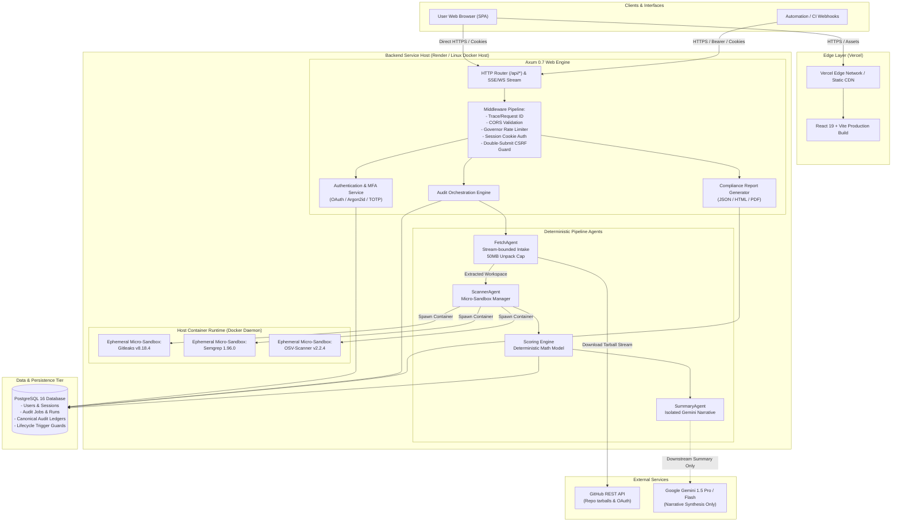
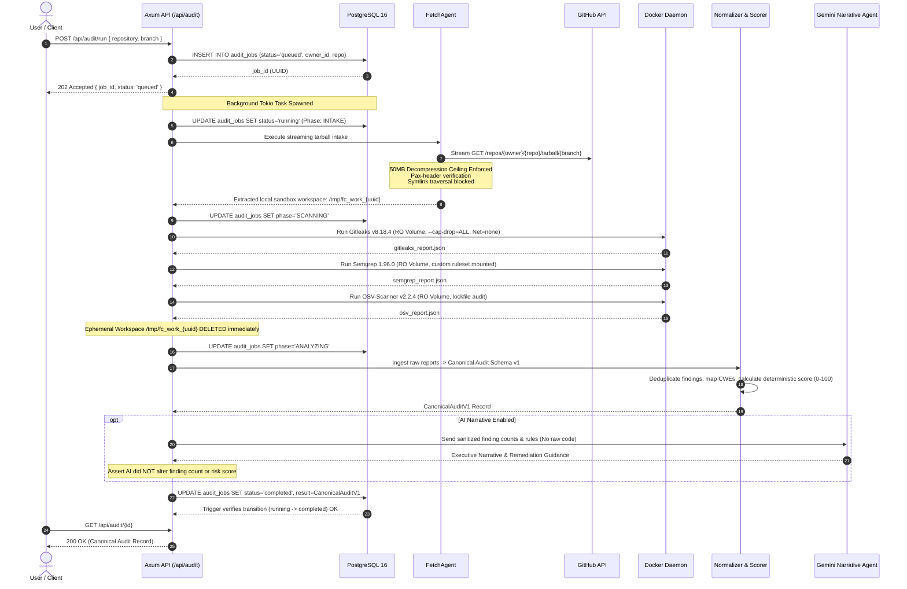
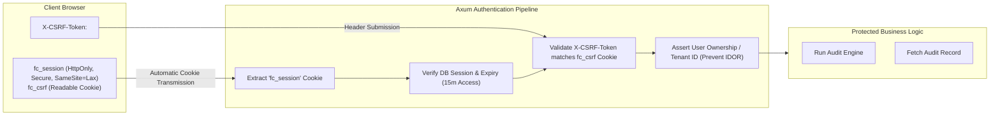
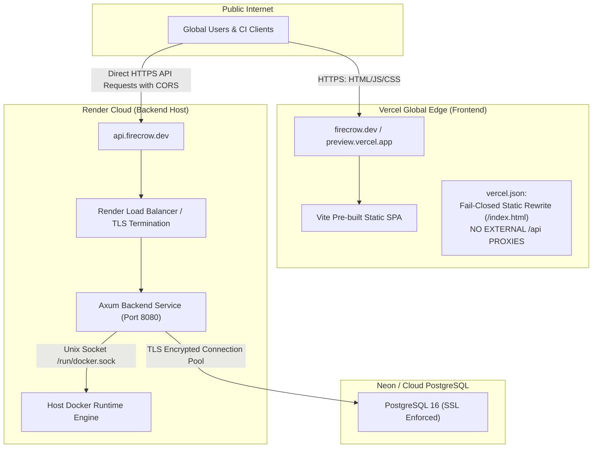

# System Architecture & Technical Overview

This document describes the end-to-end technical architecture, component boundaries, execution lifecycles, and security postures of the **FireCrow** platform.

---

## 1. System Context & Component Architecture

FireCrow is organized as a decoupled, multi-tier architecture consisting of a React 19 single-page application frontend, an asynchronous Rust (Axum 0.7) backend service, an isolated Docker container engine for sandboxed tool execution, a PostgreSQL 16 database, and external integrations with GitHub and Google Gemini.



---

## 2. End-to-End Audit Execution Lifecycle

Every repository audit traverses a strict 7-stage deterministic lifecycle. The state transitions are enforced at both the application level and the database level via a PostgreSQL `BEFORE UPDATE` trigger function (`audit_jobs_lifecycle_guard_fn`).



---

## 3. Data Ownership & Persistence Boundaries

### A. Persistent State (PostgreSQL 16)
The database is the authoritative truth for all durable records:
- **`users`**: User identities, GitHub handles, password hashes (Argon2id), roles (`admin`, `member`), TOTP secrets.
- **`user_sessions`**: Session tokens, expiration timestamps, user agent hashes, IP records.
- **`audit_jobs`**: Job status (`queued`, `running`, `completed`, `failed`), timestamps, parameters, raw error logs.
- **`audit_results`**: Fully validated **Canonical Audit Schema v1** records stored as binary JSONB, immutable upon write.
- **`organizations` / `repositories`**: Organization hierarchies and repository sync configurations.

### B. Ephemeral Host State (`/tmp/firecrow/*`)
The host filesystem stores temporary artifacts during the execution window only:
- Intake tarballs are extracted into `/tmp/firecrow/workspaces/{audit_id}` with permissions `0700`.
- Scanner containers bind-mount this directory strictly as **Read-Only** (`:ro`).
- Scanners output findings into an isolated output directory `/tmp/firecrow/outputs/{audit_id}`.
- Upon completion (or failure), the Rust orchestrator issues a recursive cleanup (`tokio::fs::remove_dir_all`) in a guaranteed cleanup guard block.
- Zero repository source code persists on disk after audit job termination.

### C. Downstream AI Boundary (Google Gemini)
- Only high-level, sanitized audit findings (finding titles, rule IDs, affected file paths, line numbers, and CVSS severities) are transmitted to the Gemini API.
- **Raw repository source code, git histories, secrets content, and intellectual property are never transmitted to the LLM.**
- Gemini outputs executive summaries and remediation blueprints. The database schema rejects any database update where finding counts or security scores diverge from the scanner normalizer output.

---

## 4. Authentication, Session & Security Boundaries



### Authentication Invariants:
1. **Cookie-Based Sessions**: Session tokens are held in `HttpOnly`, `Secure`, `SameSite=Lax` cookies. JavaScript cannot access the session token, defeating XSS token theft.
2. **Double-Submit CSRF Protection**: State-changing requests (`POST`, `PUT`, `DELETE`) require an `X-CSRF-Token` header that matches the value in the readable `fc_csrf` cookie.
3. **MFA Verification Gate**: Accounts with MFA enabled receive a pre-auth session token restricted to `/api/auth/mfa/verify`. Access to audit engines and repository data is blocked until TOTP verification succeeds.
4. **IDOR & Tenant Isolation**: Every audit query (`/api/audit/{id}`) executes with `WHERE id = $1 AND owner_id = $2` unless the authenticated user holds the `admin` role. Cross-tenant reads return `404 Not Found`.

---

## 5. Production Network Topology & Fail-Closed Routing



### Fail-Closed Routing Posture
In `vercel.json`, FireCrow deliberately configures:
```json
{
  "rewrites": [
    { "source": "/(.*)", "destination": "/index.html" }
  ]
}
```
There is **no server-side rewrite proxying `/api/*` to Render**. Instead, the React SPA makes direct client-side fetch calls to `VITE_API_URL` (e.g. `https://api.firecrow.dev`). This architecture ensures that:
- Vercel Preview deployments cannot accidentally proxy internal traffic or credentials to staging backend instances.
- Previews fail-closed if `VITE_API_URL` is omitted or unconfigured.
- Browser CORS policies strictly govern origin access to the backend API.
