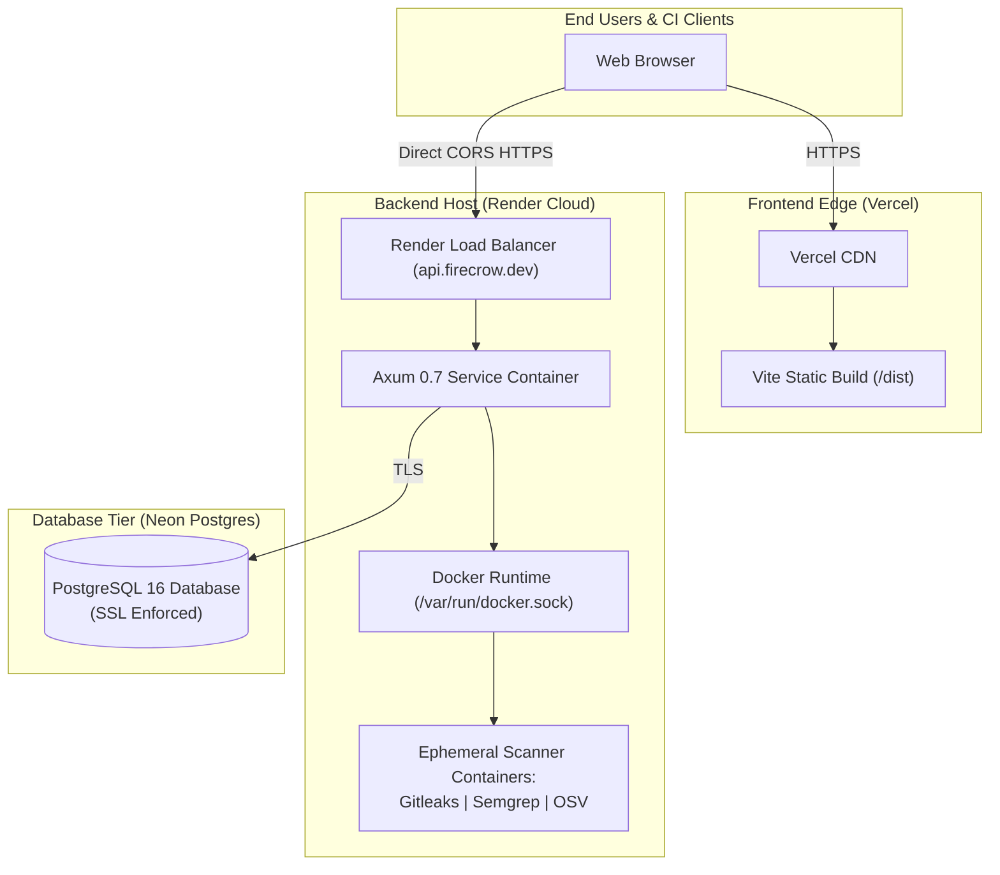

# Production Deployment Architecture

FireCrow is engineered for multi-cloud production deployment with decoupled hosting:
- **Frontend SPA**: Deployed globally on the **Vercel Edge Network** (Fast CDN, SSL termination, DDoS protection).
- **Backend Service**: Deployed on **Render** (or AWS ECS / Linux Virtual Machine with Docker runtime).
- **Persistence Tier**: Managed **PostgreSQL 16** (e.g. Neon Serverless Postgres or AWS RDS) with encrypted TLS connections.
- **Micro-Sandbox Runtime**: Host Docker engine executing ephemeral scanner containers.

---

## Deployment Documents in this Section

1. [docs/deployment/frontend.md](file:///home/ashutoshsahoo/Downloads/Fire-Crow-/docs/deployment/frontend.md) — Vercel project configuration, environment variables, security headers, and fail-closed routing rationale.
2. [docs/deployment/backend.md](file:///home/ashutoshsahoo/Downloads/Fire-Crow-/docs/deployment/backend.md) — Render configuration, `render.yaml`, multi-stage Dockerfile, health probes, and DB pool tuning.
3. [docs/deployment/containers.md](file:///home/ashutoshsahoo/Downloads/Fire-Crow-/docs/deployment/containers.md) — Container sandboxing architecture, exact security flags, and scanner image pinning.
4. [docs/deployment/release-checklist.md](file:///home/ashutoshsahoo/Downloads/Fire-Crow-/docs/deployment/release-checklist.md) — Pre-flight, cutover, post-deploy verification, and rollback procedures.

---

## Production Prerequisites Checklist

Before executing a production deployment, ensure you have:
- [ ] Vercel account with project linked to repository
- [ ] Render account with permission to spawn Docker-based web services
- [ ] Managed PostgreSQL 16 database with SSL enabled
- [ ] GitHub OAuth App registered with callback `https://api.firecrow.dev/api/auth/github/callback`
- [ ] Google Gemini API key with Gemini 1.5 Flash access
- [ ] Verified scanner container images pulled and cached on the backend host
