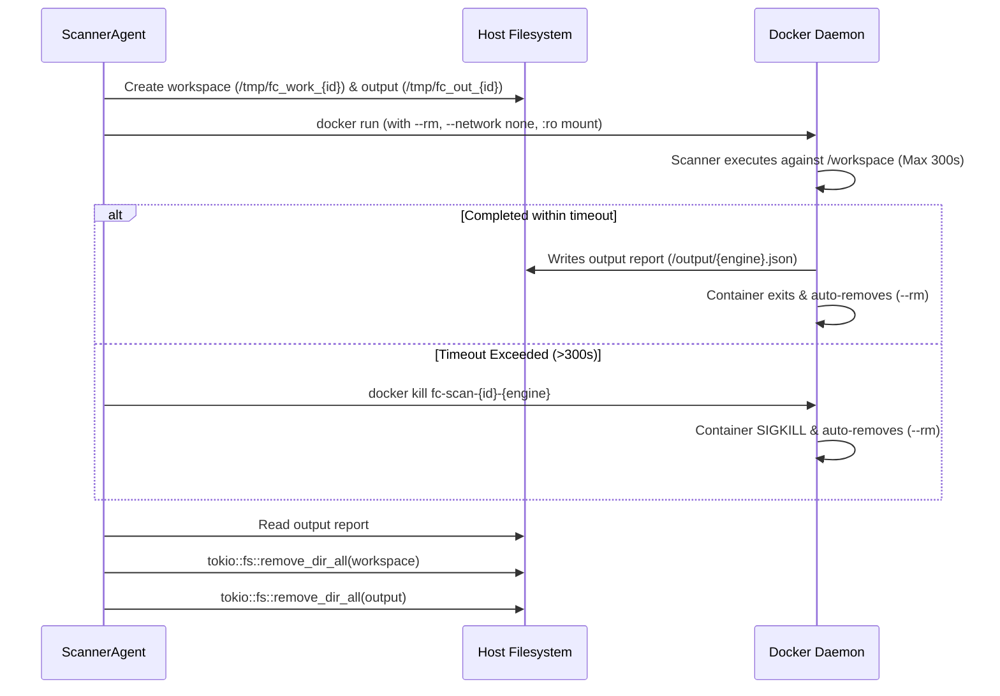

# Container Sandboxing & Security Profile Reference

This document details the container virtualization architecture, strict security containment profiles, resource quotas, and image pinning policies governing FireCrow's deterministic scanning pipeline.

---

## 1. Zero-Privilege Micro-Sandbox Philosophy

FireCrow executes untrusted customer code analysis exclusively inside ephemeral, zero-privilege Docker micro-containers. Scanners are treated as untrusted code execution runtimes:
- **No Network Access**: Containers cannot initiate outbound HTTP, DNS, or socket connections.
- **No Privilege Escalation**: All Linux capabilities are stripped; privilege escalation is blocked at the kernel level.
- **Read-Only Repository Mount**: Scanners cannot alter, inject, or tamper with the repository source code being inspected.
- **Strict Resource Caps**: CPU, memory, and process count ceilings eliminate fork bombs and resource starvation attacks.

---

## 2. Pinned Scanner Images

To guarantee reproducibility and defend against container supply-chain poisoning, scanner images are pinned to immutable releases:

| Scanner Engine | Pinned Image Reference | Ecosystem Role | Base Image |
| :--- | :--- | :--- | :--- |
| **Gitleaks** | `ghcr.io/gitleaks/gitleaks:v8.18.4` | Secrets & High-Entropy Credentials | Alpine Linux |
| **Semgrep** | `semgrep/semgrep:1.96.0` | AST SAST & OWASP Top 10 Rules | Debian Bookworm |
| **OSV-Scanner** | `ghcr.io/google/osv-scanner:v2.2.4` | Open-Source Dependency CVEs | Distroless / Scratch |

### Image Caching Command
Run during deployment initialization on the backend host:
```bash
docker pull ghcr.io/gitleaks/gitleaks:v8.18.4
docker pull semgrep/semgrep:1.96.0
docker pull ghcr.io/google/osv-scanner:v2.2.4
```

---

## 3. Mandatory Security Flags & Kernel Containment

Every scanner container spawned by `ScannerAgent` (`backend/src/agents/scanner.rs`) uses this security profile:

```bash
docker run --rm \
  --name "fc-scan-${AUDIT_ID}-${ENGINE}" \
  --network none \
  --cap-drop ALL \
  --security-opt no-new-privileges \
  --read-only \
  --pids-limit 100 \
  --memory 1024m \
  --cpus 1.0 \
  --tmpfs /tmp:rw,noexec,nosuid,size=64m \
  -v "${WORKSPACE_DIR}:/workspace:ro" \
  -v "${OUTPUT_DIR}:/output:rw" \
  "${IMAGE_NAME}" \
  ${ENGINE_CMD}
```

### Security Flag Rationale

| Docker Flag | Security Rationale |
| :--- | :--- |
| `--rm` | Guarantees container filesystem is immediately removed upon termination. |
| `--network none` | Completely severs container network stack. Prevents exfiltration of source code or discovered secrets. |
| `--cap-drop ALL` | Strips all 40+ Linux capabilities (`CAP_NET_RAW`, `CAP_SYS_ADMIN`, `CAP_CHOWN`, `CAP_SETUID`, etc.). Container cannot alter host state even if root inside container. |
| `--security-opt no-new-privileges` | Prevents processes from gaining additional privileges via `setuid` or `setgid` binaries (e.g. `sudo`, `su`). |
| `--read-only` | Mounts the container root filesystem as read-only. Disables malware persistence or runtime modification of scanner binaries. |
| `--pids-limit 100` | Limits maximum concurrently running processes inside container to 100, defeating fork bombs. |
| `--memory 1024m` | Hard memory ceiling of 1GB. Container is terminated by kernel OOM killer if memory leak or regex catastrophic backtracking occurs. |
| `--cpus 1.0` | Prevents a single scanner from starving host CPU cores. |
| `--tmpfs /tmp:...` | Creates an isolated RAM-backed scratchpad with `noexec` (cannot execute downloaded scripts) and `nosuid` attributes. |
| `-v ...:/workspace:ro` | Untrusted code workspace is mounted strictly as **Read-Only**. Scanner cannot write files into workspace. |
| `-v ...:/output:rw` | Scanner writes only its structured JSON report to this dedicated output scratchpad. |

---

## 4. Container Lifecycle & Cleanup Guarantees



### Cleanup Guarantee
Filesystem cleanup executes inside a Rust `Drop` guard. Even if a scanner container panics or returns an unexpected error code, the temporary directory on the host filesystem is recursively destroyed. Zero code artifacts persist on disk after audit job termination.
