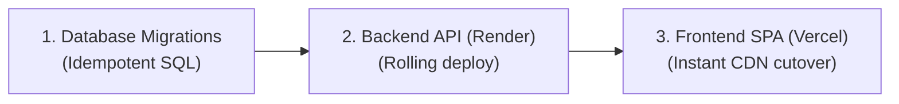

# Production Release Checklist & Cutover Runbook

This runbook outlines the required pre-flight checks, cutover sequence, smoke tests, and rollback procedures for deploying releases of FireCrow.

---

## 1. Pre-Flight Verification Phase

Before triggering a production build or promoting a release candidate:

- [ ] **Git Working Tree**: Confirm all desired changes are committed and pushed to `main`.
- [ ] **Continuous Integration**: Confirm GitHub Actions CI is passing (green) on the target commit.
- [ ] **Frontend Contract & Invariant Suite**:
  ```bash
  cd frontend
  ./node_modules/.bin/tsc -p tsconfig.app.json --noEmit
  npm run lint
  node --test dist-tests/tests/*.test.js
  ```
- [ ] **Backend Test Suite**:
  ```bash
  cd backend
  cargo test
  cargo clippy -- -D warnings
  ```
- [ ] **Migration Check**: If database migrations were added to `backend/migrations/`, verify idempotent execution on a staging database.
- [ ] **Scanner Image Cache**: Confirm target host has cached all three scanner images (`ghcr.io/gitleaks/gitleaks:v8.18.4`, `semgrep/semgrep:1.96.0`, `ghcr.io/google/osv-scanner:v2.2.4`).

---

## 2. Deployment Execution Sequence

Execute deployments in this order to avoid intermediate incompatibility:



### Step 1: Execute Database Migrations
If new migration files exist:
```bash
psql "$DATABASE_URL" -f backend/migrations/XXX_new_migration.sql
```

### Step 2: Deploy Backend to Render
1. Trigger deploy in Render dashboard or push to tracked branch.
2. Monitor build logs: verify multi-stage Docker build succeeds.
3. Verify Render health check transitions to `Healthy` (`GET /health`).

### Step 3: Deploy Frontend to Vercel
1. Vercel automatically deploys on push to `main` (or run `vercel --prod`).
2. Verify build output finishes cleanly without TypeScript or bundler errors.

---

## 3. Post-Deployment Verification (Smoke Tests)

Execute the following smoke tests against production endpoints:

### 1. API Health Check
```bash
curl -i https://api.firecrow.dev/health
```
- Must return `HTTP/1.1 200 OK` with JSON payload.

### 2. Deep Readiness & Database Probe
```bash
curl -i https://api.firecrow.dev/ready
```
- Must return `HTTP/1.1 200 OK` with `"database": "connected"`.

### 3. Frontend Web & Security Headers Check
```bash
curl -I https://firecrow.dev
```
- Verify presence of security headers:
  - `X-Content-Type-Options: nosniff`
  - `X-Frame-Options: DENY`
  - `Referrer-Policy: strict-origin-when-cross-origin`

### 4. End-to-End Audit Smoke Test
1. Log into the web application at `https://firecrow.dev`.
2. Select a verified small public test repository (e.g. `johan-droid/firecrow-test-fixture`).
3. Click **Start Audit** and verify real-time SSE progress updates.
4. Verify audit transitions cleanly to `completed`.
5. Verify risk score ring renders with correct grade color.
6. Verify Canonical Audit JSON download and PDF export function correctly.

---

## 4. Emergency Rollback Procedure

If fatal regressions, database errors, or service outages occur:

### Rollback Frontend (Vercel)
1. Open Vercel Dashboard ➔ Deployments.
2. Locate the previous stable deployment.
3. Click `...` ➔ **Promote to Production**. (Cutover occurs in < 5 seconds globally).

### Rollback Backend (Render)
1. Open Render Dashboard ➔ `firecrow-api` ➔ Deploys.
2. Select previous known-good deployment commit.
3. Click **Rollback to this deploy**.

### Rollback Database Migrations (If Needed)
If a database schema change introduced incompatibilities, run the corresponding rollback script:
```bash
psql "$DATABASE_URL" -f backend/migrations/rollback/XXX_rollback.sql
```
