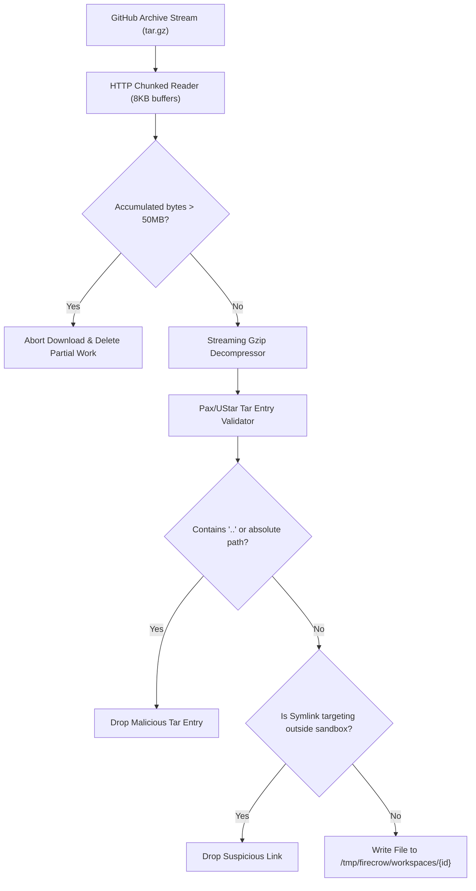

# Backend Architecture & Systems Engineering Guide

This guide details the internal engineering of the FireCrow backend service: the Axum web framework, streaming intake safeguards, Docker micro-container sandboxing, Canonical Audit v1 normalization, deterministic scoring mathematics, and PostgreSQL lifecycle triggers.

---

## 1. Axum 0.7 Architecture & Runtime

The backend is built in **Rust 1.85+** using the **Axum 0.7** asynchronous web framework on top of the **Tokio** multi-threaded runtime.

### Router & State Hierarchy (`backend/src/app.rs`)
The router is assembled with hierarchical state injection:
```rust
pub struct AppState {
    pub pool: sqlx::PgPool,
    pub config: Arc<AppConfig>,
    pub audit_queue: Arc<AuditQueue>,
    pub rate_limiter: Arc<GovernorLimiter>,
}
```

Routes are categorized into functional sub-routers:
- `/health`, `/healthz`, `/ready`: Public monitoring and readiness probes.
- `/api/auth/*`: Session authentication, GitHub OAuth2, and TOTP MFA verification.
- `/api/audit/*`: Audit initiation, status tracking, canonical result queries, and exports.
- `/api/github/*`: Repository listing and metadata synchronization.

### Middleware Pipeline
Requests execute through an onion-layered Tower middleware stack:
1. **Trace & Request ID**: Assigns a unique `X-Request-ID` UUID to every incoming HTTP request and initializes Tokio tracing spans.
2. **CORS Validation**: Evaluates the `Origin` header against `CORS_ALLOWED_ORIGINS`. Preflight `OPTIONS` requests receive validated headers.
3. **Governor Rate Limiting**: Token-bucket rate limiting applied globally and with custom quota buckets on sensitive endpoints.
4. **Session Extraction & Cookie Guard**: Decrypts the `fc_session` cookie and verifies user state against the database.
5. **Double-Submit CSRF Guard**: Validates that mutating requests (`POST`, `PUT`, `DELETE`, `PATCH`) carry an `X-CSRF-Token` matching the client-accessible `fc_csrf` token.

---

## 2. Ingestion Engine & Stream-Bounded Intake (`FetchAgent`)

Located at `backend/src/agents/fetch.rs`, the `FetchAgent` implements robust defenses against malicious repositories, archive bombs, and resource exhaustion before any scanner executes.



### Key Intake Bounds:
- **Streaming Ingestion**: The HTTP body is consumed in bounded chunks via `reqwest::Response::bytes_stream()`. The archive is never buffered entirely into memory.
- **Decompression Ceiling (Anti-Bomb)**: Maximum unpacked archive size is hard-capped at **50 MB** (`MAX_UNPACK_BYTES = 52_428_800`). If an archive expands beyond 50MB, extraction aborts immediately with a `QuotaExceeded` error.
- **Path Traversal Protection**: Every tar entry path is inspected. Any entry containing relative directory traversal components (`..`) or leading root slashes (`/`) is rejected.
- **Symlink Jail**: Symlinks pointing outside the ephemeral workspace directory are dropped to prevent reading host system files (`/etc/passwd`, Docker socket, etc.).
- **Permissions Cleansing**: File permissions inside the extracted directory are normalized to `0600` for files and `0700` for directories. Executable bits (`0755`) are removed from all untrusted files.

---

## 3. Sandboxed Container Orchestration (`ScannerAgent`)

Located at `backend/src/agents/scanner.rs`, the `ScannerAgent` coordinates scanner execution via the host Docker daemon (`/var/run/docker.sock` or TCP socket).

### Pinned Scanner Images
To prevent supply-chain drift and ensure 100% deterministic reproducibility, scanner image tags are strictly pinned:
- **Gitleaks**: `ghcr.io/gitleaks/gitleaks:v8.18.4`
- **Semgrep**: `semgrep/semgrep:1.96.0`
- **OSV-Scanner**: `ghcr.io/google/osv-scanner:v2.2.4`

### Docker Security Flags & Containment Profile
Every scanner container is spawned with zero privileges and hard resource ceilings:

```bash
docker run --rm \
  --name "fc-scan-${AUDIT_ID}-${ENGINE}" \
  --network none \
  --cap-drop ALL \
  --security-opt no-new-privileges \
  --read-only \
  --pids-limit 100 \
  --memory 1024m \
  --cpus 1.0 \
  --tmpfs /tmp:rw,noexec,nosuid,size=64m \
  -v "${WORKSPACE_DIR}:/workspace:ro" \
  -v "${OUTPUT_DIR}:/output:rw" \
  "${SCANNER_IMAGE}" \
  ${ENGINE_SPECIFIC_ARGS}
```

### Engine-Specific Invocation Commands

#### 1. Gitleaks
```bash
docker run --rm [SECURITY_FLAGS] \
  -v "${WORKSPACE}:/workspace:ro" \
  -v "${OUTPUT}:/output:rw" \
  ghcr.io/gitleaks/gitleaks:v8.18.4 \
  detect --source=/workspace --report-format=json --report-path=/output/gitleaks.json --no-git --exit-code=0
```
- Timeout: **300 seconds**
- Scans files for high-entropy tokens, AWS keys, GitHub PATs, and private keys.

#### 2. Semgrep (SAST)
```bash
docker run --rm [SECURITY_FLAGS] \
  -v "${WORKSPACE}:/workspace:ro" \
  -v "${RULES_FILE}:/rules/firecrow-sast.yml:ro" \
  -v "${OUTPUT}:/output:rw" \
  semgrep/semgrep:1.96.0 \
  semgrep scan --config=/rules/firecrow-sast.yml --json --output=/output/semgrep.json --disable-version-check /workspace
```
- Timeout: **300 seconds**
- Host mounts custom OWASP/CWE rule file: `backend/scanners/semgrep/firecrow-sast.yml` read-only.

#### 3. OSV-Scanner (Dependencies)
```bash
docker run --rm [SECURITY_FLAGS] \
  -v "${WORKSPACE}:/workspace:ro" \
  -v "${OUTPUT}:/output:rw" \
  ghcr.io/google/osv-scanner:v2.2.4 \
  --format=json --output=/output/osv.json -r /workspace
```
- Timeout: **300 seconds**
- Scans lockfiles (`package-lock.json`, `Cargo.lock`, `go.sum`, `requirements.txt`, `composer.lock`, etc.) against Google OSV CVE database.

---

## 4. Normalization & Deterministic Risk Scoring

### Canonical Audit Schema v1 (`backend/src/schemas/canonical_audit.rs`)
Raw scanner output files are parsed and mapped into the canonical representation:

```rust
#[derive(Debug, Clone, Serialize, Deserialize)]
pub struct CanonicalAuditV1 {
    pub schema_version: String,          // "1.0.0"
    pub audit_id: Uuid,
    pub repository: String,
    pub commit_sha: String,
    pub score: u32,                      // 0 - 100
    pub grade: String,                  // "A", "B", "C", "D", "F"
    pub status: AuditJobStatus,
    pub summary: AuditSummary,
    pub findings: Vec<CanonicalFinding>,
    pub engines_executed: Vec<EngineExecution>,
    pub created_at: DateTime<Utc>,
    pub completed_at: DateTime<Utc>,
}

#[derive(Debug, Clone, Serialize, Deserialize)]
pub struct CanonicalFinding {
    pub id: String,                      // Deterministic hash: SHA256(engine + rule_id + path + line)
    pub engine: String,                  // "gitleaks" | "semgrep" | "osv-scanner"
    pub rule_id: String,
    pub title: String,
    pub description: String,
    pub severity: Severity,              // Critical | High | Medium | Low | Info
    pub category: String,                // "Secret Leak" | "SAST" | "Vulnerable Dependency"
    pub file_path: String,
    pub start_line: u32,
    pub end_line: u32,
    pub cwe_ids: Vec<String>,
    pub remediation: Option<String>,
}
```

### Deterministic Risk Score Mathematics
The overall security score (0–100) is derived from a transparent, monotonic penalty deduction function:

$$\text{Base Score} = 100$$
$$\text{Penalty} = (N_{\text{critical}} \times 25) + (N_{\text{high}} \times 15) + (N_{\text{medium}} \times 5) + (N_{\text{low}} \times 1) + (N_{\text{info}} \times 0)$$
$$\text{Calculated Score} = \max(0, 100 - \text{Penalty})$$

| Severity | Penalty Points | Justification |
| :--- | :---: | :--- |
| **Critical** | **-25** | Direct exploitability / plaintext production secrets / RCE. 4 Critical findings = Score 0. |
| **High** | **-15** | SQLi, SSRF, authentication bypass, high CVSS dependency vulnerability. |
| **Medium** | **-5** | CSRF missing, permissive CORS, outdated secondary dependency. |
| **Low** | **-1** | Minor configuration defect, informational leakage. |
| **Info** | **0** | Informational security hygiene indicator. |

### Letter Grade Mapping:
- **90 – 100**: `A` (Clean posture)
- **75 – 89**: `B` (Minor low/medium issues)
- **50 – 74**: `C` (Significant medium/high risks)
- **25 – 49**: `D` (High risks or multiple criticals)
- **0 – 24**: `F` (Severe breach-level vulnerabilities present)

---

## 5. PostgreSQL Database Schema & Lifecycle Triggers

### State Machine Trigger Guard (`audit_jobs_lifecycle_guard_fn`)
Enforced in PostgreSQL 16 via a `BEFORE UPDATE` trigger on `audit_jobs`:

```sql
CREATE OR REPLACE FUNCTION audit_jobs_lifecycle_guard_fn()
RETURNS TRIGGER AS $$
BEGIN
    -- Permit timestamp/metadata updates within the same status
    IF OLD.status = NEW.status THEN
        RETURN NEW;
    END IF;

    -- Valid state transitions:
    -- queued -> running
    -- running -> completed
    -- running -> failed
    -- queued -> failed (e.g. cancellation)
    IF (OLD.status = 'queued' AND NEW.status = 'running') OR
       (OLD.status = 'running' AND NEW.status = 'completed') OR
       (OLD.status = 'running' AND NEW.status = 'failed') OR
       (OLD.status = 'queued' AND NEW.status = 'failed') THEN
        NEW.updated_at = NOW();
        RETURN NEW;
    END IF;

    -- Any other transition is illegal
    RAISE EXCEPTION 'Illegal audit job status transition from % to % for job %',
        OLD.status, NEW.status, OLD.id;
END;
$$ LANGUAGE plpgsql;

CREATE TRIGGER audit_jobs_lifecycle_guard
BEFORE UPDATE ON audit_jobs
FOR EACH ROW
EXECUTE FUNCTION audit_jobs_lifecycle_guard_fn();
```

---

## 6. AI Narrative Layer & Boundary Verification (`SummaryAgent`)

Located at `backend/src/agents/summary.rs`, the `SummaryAgent` interacts with the Google Gemini 1.5 API:

1. **Payload Sanitization**: The agent extracts only finding totals, rule names, file extensions, and severity distributions. Raw code snippets and tarball contents are strictly stripped.
2. **Prompt Hardening**: The system prompt instructs Gemini to generate only a high-level executive summary and remediation priority list.
3. **Post-Synthesis Assertion**: When Gemini returns a response, the backend code executes a structural invariant check:
   - Does `response.finding_count == canonical_audit.findings.len()`?
   - Does the response attempt to override `score`?
   - If any discrepancy is detected, the AI summary is discarded and replaced with a deterministic template summary.
