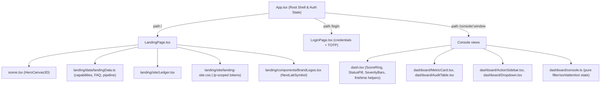

# Frontend Architecture & UI Engineering Guide

This guide details the technical architecture, component hierarchy, design token system, state management, and testing conventions of the FireCrow frontend.

---

## 1. Technical Stack & Build Setup

The FireCrow frontend is an enterprise-grade Single Page Application (SPA) designed with a data-first security engineering aesthetic:
- **Framework**: React 19 (`react`, `react-dom`)
- **Language**: TypeScript 5.7+ with strict type checking
- **Bundler & Dev Server**: Vite 8.1+ (`vite`)
- **Icons**: Lucide React (`lucide-react`)
- **Styling**: Pure semantic CSS with custom CSS Custom Properties (Design Tokens), zero runtime CSS-in-JS overhead.

### TypeScript Configuration
- `tsconfig.app.json`: Configures the React compiler target (`ES2022`), DOM library bindings, JSX runtime (`react-jsx`), and strict linting (`noUnusedLocals`, `noUnusedParameters`).
- `tsconfig.node.json`: Configures tooling scripts for Vite.

---

## 2. Component Hierarchy & Navigation Routing

FireCrow routes on the **URL** with `react-router-dom` (`BrowserRouter`, mounted in `frontend/src/main.tsx`). `frontend/src/App.tsx` is the root shell: it holds auth/session state and renders the landing page, the login page, or the console according to the current path. Because routing is path-based, deep links such as `/console/overview` depend on the host's SPA fallback — see `docs/deployment/frontend.md`.



### Routes
- `/`: public landing page (`LandingPage.tsx`).
- `/login`: credentials + TOTP (`LoginPage.tsx`); returns the user to the requested path after auth.
- `/console/:window`: authenticated console. Windows are `overview`, `repositories`, `audits`, `findings`, `settings`; `/console` redirects to `/console/overview`, and legacy segments (`jobs`, `reports`, `diagnostics`, `sso`, `pam`, `iam`, `domains`, `mfa`) redirect to the current names. `dashboard/console.ts` holds the pure, unit-tested view state (filtering, sorting, attention rules).

---

## 3. API Client & Session Management (`frontend/src/api/client.ts`)

The API client encapsulates all network communication with the Axum backend service:

### Core Client Features:
1. **Dynamic Origin Resolution** (`getApiBase()` → `resolveApiBase()` in `frontend/src/api/api-base.ts`):
   ```typescript
   resolveApiBase(import.meta.env.VITE_API_URL); // '/api/v1' when unset; a malformed absolute URL is rejected loudly
   ```
   In a decoupled deployment the SPA calls the backend origin named by `VITE_API_URL` (e.g. `https://<service>.onrender.com`; the `/api/v1` suffix is appended automatically). Locally the `/api/v1` default is proxied by the Vite dev server to `http://localhost:8000` (`vite.config.ts`), which keeps auth cookies first-party.
2. **CSRF Posture (Origin Allowlist)**:
   The backend enforces an `Origin`-header allowlist on all mutating requests (`POST`, `PUT`, `PATCH`, `DELETE`); cookie-bearing mutations with no `Origin` header are rejected (`backend/src/middleware/csrf.rs`). The client sends no CSRF token header — requests only need to come from an allowlisted origin.
3. **Credentials Inclusion**:
   All fetch requests include `credentials: 'include'` to ensure `HttpOnly` session cookies (`fc_access_token`) are transmitted across cross-origin requests.
4. **Typed Response DTOs**:
   All endpoints return strongly typed TypeScript interfaces matching backend models (`CanonicalAuditRecord`, `AuditJobDTO`, `UserSessionDTO`).

---

## 4. Design Tokens & Visual Hierarchy

Tokens are per-surface and scoped, so one surface's theme can never re-theme another (asserted in `frontend/tests/dashboard.test.ts`):

| Surface | Stylesheet | Token prefix |
| --- | --- | --- |
| Base / shared | `frontend/src/index.css` | `--bg-*`, `--text-*`, `--font-*`, `--apple-*` |
| Console | `frontend/src/dashboard.css` | `--fc-*` (`--fc-canvas`, `--fc-surface`, `--fc-accent`, …) |
| Landing | `frontend/src/landing/site/landing-site.css` | `--lp-*`, defined on the `.lp` root class |

The console canvas is true black (`--fc-canvas: #000000`) with an ember accent
(`--fc-accent: #E5484D`). The marketing surfaces are deep dark with a single
elevated object (the ledger). `frontend/src/console-theme.css` carries the
console reset/overrides; `frontend/src/login-site.css` styles the sign-in page.

### Contrast & Accessibility (WCAG 2.1 AA)
- Body text is white on the near-black canvas (`--text-primary: #ffffff` on
  `--bg-primary: #070709`), comfortably above the 4.5:1 AA requirement.
- Interactive elements show a visible focus ring: `outline: 2px solid
  var(--fc-accent)` (`dashboard.css`).
- Status badges pair border and text with color, so status stays legible
  without relying on color alone.

---

## 5. Verification & Testing Commands

To verify frontend code quality and type safety:

```bash
# 1. Typecheck the application
./node_modules/.bin/tsc -p tsconfig.app.json --noEmit

# 2. Typecheck Vite tooling
./node_modules/.bin/tsc -p tsconfig.node.json --noEmit

# 3. Run the linter (oxlint)
npm run lint

# 4. Production build test
npm run build

# 5. Run the headless test suite (typecheck + node:test)
npm test
```
