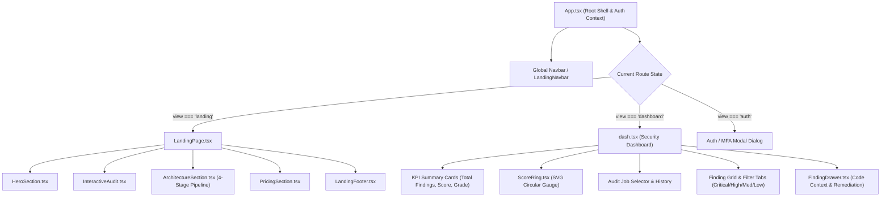

# Frontend Architecture & UI Engineering Guide

This guide details the technical architecture, component hierarchy, design token system, state management, and testing conventions of the FireCrow frontend.

---

## 1. Technical Stack & Build Setup

The FireCrow frontend is an enterprise-grade Single Page Application (SPA) designed with a data-first security engineering aesthetic:
- **Framework**: React 19 (`react`, `react-dom`)
- **Language**: TypeScript 5.7+ with strict type checking
- **Bundler & Dev Server**: Vite 8.1+ (`vite`)
- **Icons**: Lucide React (`lucide-react`)
- **Styling**: Pure semantic CSS with custom CSS Custom Properties (Design Tokens), zero runtime CSS-in-JS overhead.

### TypeScript Configuration
- `tsconfig.app.json`: Configures the React compiler target (`ES2022`), DOM library bindings, JSX runtime (`react-jsx`), and strict linting (`noUnusedLocals`, `noUnusedParameters`).
- `tsconfig.node.json`: Configures tooling scripts for Vite.

---

## 2. Component Hierarchy & Navigation Routing

FireCrow implements state-driven view routing in `frontend/src/App.tsx`, providing instant switching without full page reloads:



### View Navigation States
- `'landing'`: Public conversion page presenting the platform capabilities, deterministic scanning pipeline, interactive audit walkthrough, and pricing models.
- `'dashboard'`: Authenticated engineering dashboard displaying active audits, canonical findings, score breakdowns, and export utilities.
- `'auth'`: Modal overlay handling login credentials and two-factor TOTP verification.

---

## 3. API Client & Session Management (`frontend/src/services/api.ts`)

The API client encapsulates all network communication with the Axum backend service:

### Core Client Features:
1. **Dynamic Origin Resolution**:
   ```typescript
   const API_BASE = import.meta.env.VITE_API_URL || '/api';
   ```
   In production on Vercel, requests route directly to the decoupled backend host (e.g. `https://api.firecrow.dev`). In local development with Vite dev server, requests route to `http://localhost:8080`.
2. **CSRF Posture (Origin Allowlist)**:
   The backend enforces an `Origin`-header allowlist on all mutating requests (`POST`, `PUT`, `PATCH`, `DELETE`); cookie-bearing mutations with no `Origin` header are rejected (`backend/src/middleware/csrf.rs`). The client sends no CSRF token header — requests only need to come from an allowlisted origin.
3. **Credentials Inclusion**:
   All fetch requests include `credentials: 'include'` to ensure `HttpOnly` session cookies (`fc_access_token`) are transmitted across cross-origin requests.
4. **Typed Response DTOs**:
   All endpoints return strongly typed TypeScript interfaces matching backend models (`CanonicalAuditRecord`, `AuditJobDTO`, `UserSessionDTO`).

---

## 4. Design Tokens & Visual Hierarchy

The FireCrow design system combines warm ivory surfaces, sophisticated obsidian dark tones, and high-contrast security indicators:

### Core Token Palette (`frontend/src/index.css`)
```css
:root {
  /* Surfaces & Backgrounds */
  --bg-primary: #0A0A0A;
  --bg-surface: #121212;
  --bg-surface-elevated: #1A1A1A;
  --bg-surface-hover: #222222;

  /* Borders & Dividers */
  --border-subtle: #242424;
  --border-prominent: #333333;
  --border-specular: rgba(255, 255, 255, 0.08);

  /* Typography & Foreground */
  --text-primary: #F5F5F7;
  --text-secondary: #A1A1A6;
  --text-tertiary: #6E6E73;

  /* Deterministic Score & Severity Tokens */
  --severity-critical: #EF4444;   /* Red 500 */
  --severity-high: #FF7849;       /* Bright Orange */
  --severity-medium: #F59E0B;     /* Amber 500 */
  --severity-low: #3B82F6;        /* Blue 500 */
  --severity-info: #64748B;       /* Slate 500 */

  /* Grade Ring Accents */
  --grade-a: #22C55E;             /* Green 500 (Score 90-100) */
  --grade-b: #F59E0B;             /* Amber 500 (Score 75-89) */
  --grade-c: #FF7849;             /* Orange (Score 50-74) */
  --grade-d: #EF4444;             /* Red 500 (Score 0-49) */
}
```

### Contrast & Accessibility (WCAG 2.1 AA)
- Text colors (`#F5F5F7` on `#0A0A0A`) maintain a contrast ratio exceeding **16:1** (well above the 4.5:1 AA requirement).
- Interactive buttons and links provide distinct focus rings (`outline: 2px solid #FF3B30`).
- Status badges use specular 1px borders and high-contrast text to remain legible without relying on color alone.

---

## 5. Verification & Testing Commands

To verify frontend code quality and type safety:

```bash
# 1. Typecheck the application
./node_modules/.bin/tsc -p tsconfig.app.json --noEmit

# 2. Typecheck Vite tooling
./node_modules/.bin/tsc -p tsconfig.node.json --noEmit

# 3. Run ESLint rules
npm run lint

# 4. Production build test
npm run build

# 5. Run headless test suite (166 node tests)
node --test dist-tests/tests/*.test.js
```
