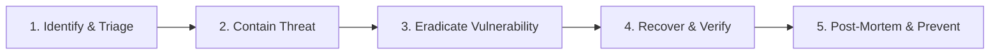

# Security Incident Response Plan & Playbooks

This runbook defines the severity classification, operational workflow, communication templates, and post-mortem procedures for handling security incidents involving FireCrow.

---

## 1. Incident Severity Classification

| Tier | Severity | Definition & Examples | SLA / Response Target | Escalation Lead |
| :---: | :--- | :--- | :---: | :--- |
| **P1** | **Critical** | Container breakout, source code leak, cross-tenant IDOR leak, root credential compromise. | **< 15 minutes** | Head of Engineering + Security Lead |
| **P2** | **High** | Widespread scanner crash loop, DB lifecycle trigger bypass, DoS on intake, broken rate limiter. | **< 1 hour** | On-call Systems Engineer |
| **P3** | **Medium** | Google Gemini API outage (fallback engaged), minor UI display error, export formatting issue. | **< 4 hours** | Lead Developer |
| **P4** | **Low** | Informational defect, documentation mismatch, low-priority false positive. | **Next Release** | Engineering Team |

---

## 2. Emergency Operational Kill-Switches

In the event of an active P1 container anomaly or host intrusion alert:

### 1. Terminate All Active Scanner Containers
```bash
# Forcefully kill and remove all running FireCrow scan micro-containers
docker ps -q --filter "name=fc-scan" | xargs -r docker kill
```

### 2. Purge Host Ephemeral Workspaces
```bash
# Recursively wipe all active and stranded workspace code on host
rm -rf /tmp/firecrow/workspaces/* /tmp/firecrow/outputs/*
```

### 3. Immediate Session Invalidation (Global Logout)
Rotate the `SESSION_SECRET` and `JWT_SECRET` in the Render management dashboard. All active user cookies will fail signature validation immediately, terminating all sessions across the platform.

---

## 3. Five-Phase Incident Response Lifecycle



### Phase 1: Identification & Triage
1. Acknowledge the alert from monitoring (Sentry, Render logs, user report).
2. Triage severity (P1–P4) based on data exposure and impact.
3. Open an incident tracking war room (Slack/Discord/Incident channel).

### Phase 2: Containment
1. If the vulnerability involves repository ingestion or scanning, temporarily pause new audit job ingestion via feature flag or maintenance mode.
2. If credentials or session tokens were exposed, execute emergency kill-switch #3 (Session Invalidation).
3. If container breakout suspected, isolate backend host and review Docker daemon logs.

### Phase 3: Eradication
1. Develop and test a targeted fix on a local isolated branch.
2. Write automated regression tests verifying the exploit vector is sealed.
3. Verify test pass:
   ```bash
   node --test dist-tests/tests/*.test.js
   cargo test
   ```

### Phase 4: Recovery & Verification
1. Deploy hotfix following the [Production Release Checklist](../../../../../../docs/deployment/release-checklist.md).
2. Execute end-to-end smoke tests and database readiness probes.
3. Restore public audit intake.

### Phase 5: Post-Mortem & Remediation
1. Author a comprehensive Root Cause Analysis (RCA) document within 48 hours.
2. Document timeline of detection, response, containment, and resolution.
3. Update [Threat Model](../../../../../../docs/security/threat-model.md) and security regression test suite.
